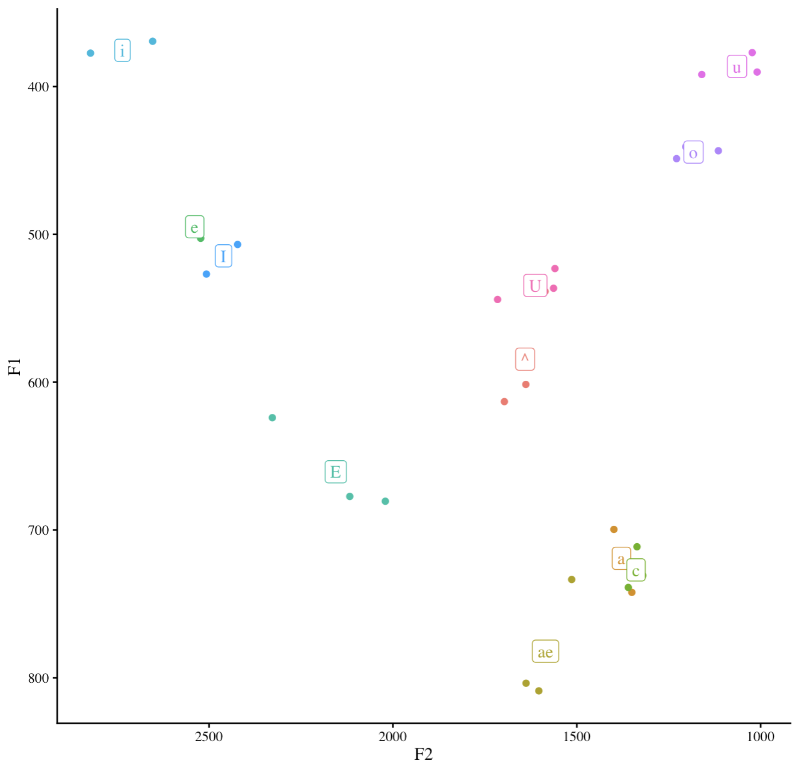
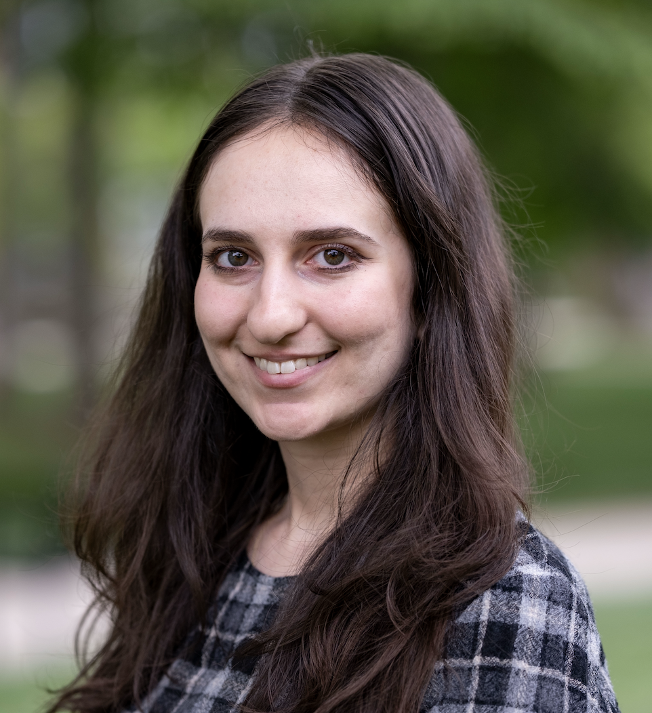

:::: {.row}

::: {.col-md-8}
When I'm not doing linguistics, you can probably find me reading or browsing Wikipedia. Here's some important things to know about me.

## My vowels
{width=600px}

Not only do I have a full cot-caught merger, but I have /e/-/ɪ/ reversal and a pretty back pronunciation of /u/.

## Currently reading
My current book is  Orlando by Virgnia Woolf. Recommend me a book [here](https://docs.google.com/forms/d/e/1FAIpQLSf1QMLSt3UkkW0mGpQGg8gKRy6_TqLhf1_-TsY-6FC7xW_B-A/viewform?usp=publish-editor)!

:::

::: {.col-md-4}

::: {.polaroid}
{width=300px}

PhD student at Rutgers Linguistics

[zk210@rutgers.edu](mailto:zk210@rutgers.edu), she/her
:::

::::
:::