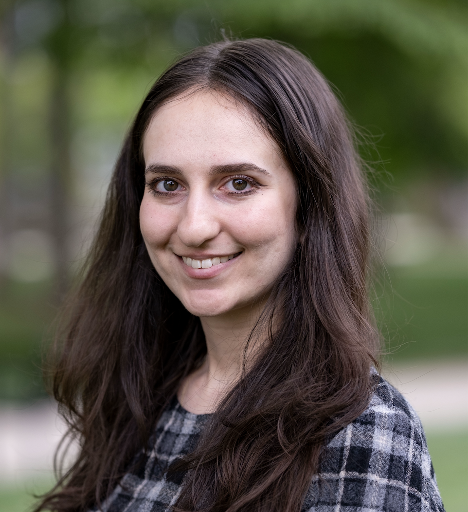

:::: {.row}

::: {.col-md-8}
## Current projects
I'm currently conducting fieldwork on Banjara, an Indo-Aryan language spoken in India. More generally, I also work on Turkic phonology & phonetics.

## Talks and presentations
*Decomposing bounded iterativity in Kazakh rounding harmony*.
Talk, Annual Meeting on Phonology (AMP), College Park, MD, USA.October 09, 2026.
Colin Hirschberg, Timur Akishev, Merlin Balkhash, **Zoe Katz**, Utku Zobarlar, Adam McCollum. Presented by Colin & Utku.

*Not all round vowels are created equal: Trigger asymmetries in Kazakh rounding harmony*.
Talk, 11th Workshop on Turkic and Languages in Contact with Turkic (Tu+ 11), Boston, MA, USA. April 12, 2026.
Colin Hirschberg, Timur Akishev, Merlin Balkhash, **Zoe Katz**, Utku Zobarlar, Adam McCollum. Presented by Colin & Utku.

## Fieldwork
One of my passions is documentary and descriptive linguistics. As a undergraduate, I conducted sociolinguistic fieldwork in Bangkok, Thailand. I have also worked on Turkish and Kurdish. Currently, I am working with a speaker of Banjara from the Indian state Telangana. 
:::

::: {.col-md-4}

::: {.polaroid}
{width=300px}

PhD student at Rutgers Linguistics

[zk210@rutgers.edu](mailto:zk210@rutgers.edu)
:::

:::

::::