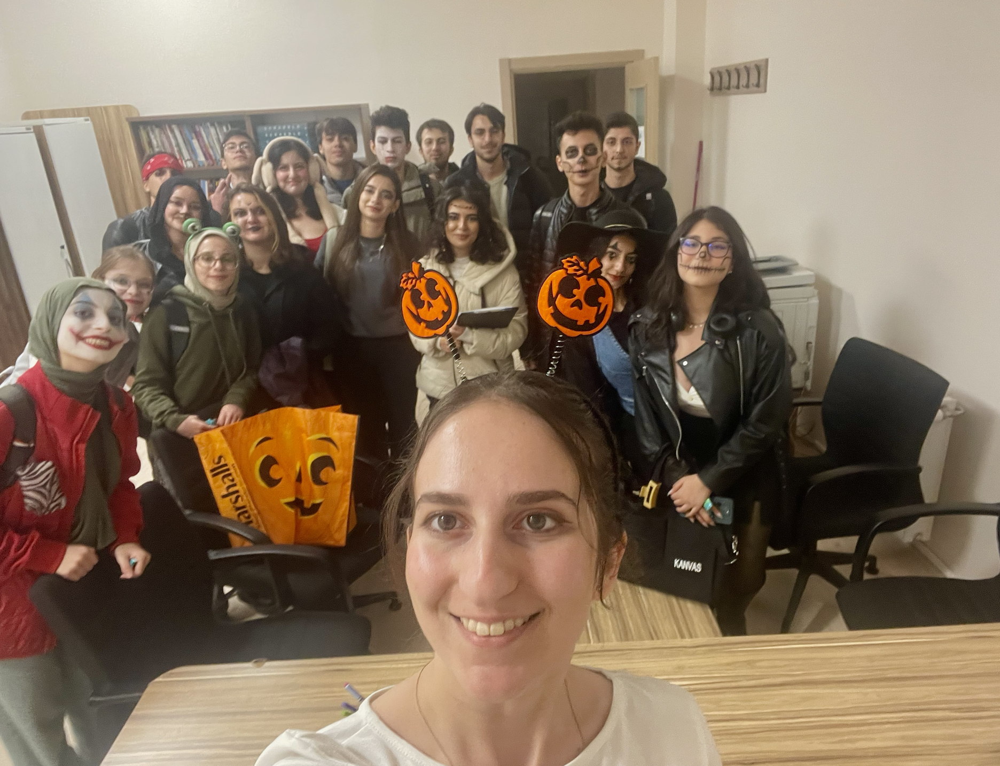

:::: {.row}

::: {.col-md-8}

### [2024-2025]{.accent}
#### Fulbright English Teaching Fellowship
English Teacher, Erzurum Technical University, 2024

Here's a photo of me and my students from Erzurum during Halloween 2024:

{width=300px}

### [2023-2024]{.accent}
#### Introduction to the Study of Language
Teaching Assistant, Rice University, Department of Linguistics, 2024

#### Introduction to Program Design
Teaching Assistant, Rice University, Department of Computer Science, 2023

### [2022-2023]{.accent}
#### Algorithmic Thinking
Teaching Assistant, Rice University, Department of Computer Science, 2023

#### Introduction to Program Design
Teaching Assistant, Rice University, Department of Computer Science, 2022

### [2021-2022]{.accent}
#### Phonetics
Teaching Assistant, Rice University, Department of Linguistics, 2022
:::

::: {.col-md-4}

::: {.polaroid}
{width=300px}

PhD student at Rutgers Linguistics

[zk210@rutgers.edu](mailto:zk210@rutgers.edu), she/her
:::

:::
::::